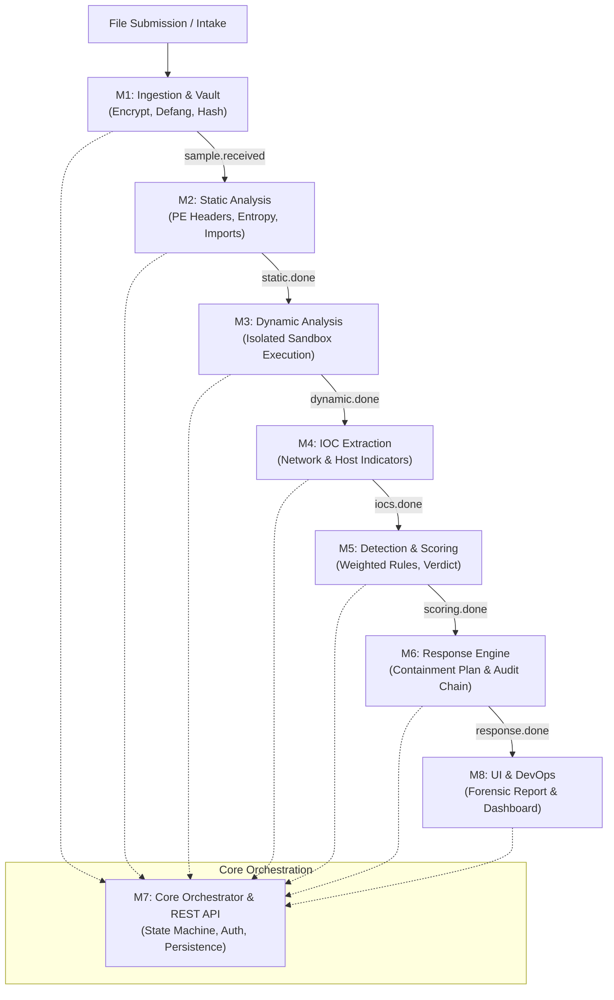

# TRAC: Trojan Response and Analysis Command Platform
## Comprehensive Technical Documentation & Architecture Reference
**Version:** 1.0.0  
**Contract Version:** 1.0.0  
**Classification:** TLP:CLEAR / Defensive Operations  

---

## 1. Executive Summary & Platform Overview

**TRAC (Trojan Response and Analysis Command Platform)** is an enterprise-grade, contract-first malware and trojan analysis system. It is designed to orchestrate the complete lifecycle of suspicious binary inspection: from secure cryptographic intake and sandbox execution, to indicator extraction, heuristic scoring, automated response planning, and forensic report generation.

### Core Design Principles
- **Contract-First Architecture:** The shared contract (`contract/schemas/analysis_result.schema.json` and `contract/pipeline/state_machine.yaml`) acts as the single source of truth across all 8 modules. No module may write outside its designated sections.
- **Strict Vault Security:** Files are never referenced or stored via local filesystem paths; samples are encrypted at rest using AES/Fernet, defanged via XOR byte-scrambling, and addressed exclusively via `vault_id` UUIDs.
- **Dual-Control Human-in-the-Loop Response:** Autonomous response planning enforces approval gates. High-risk destructive containment actions (host isolation, IP/domain blocking) require explicit analyst or approver approval before execution.
- **Tamper-Evident Audit Chains:** All response actions are cryptographically chained with SHA-256 hashes to guarantee provenance and audit integrity for legal and incident response operations.
- **Defanged Threat Intelligence:** All network indicators (IPs, URLs, domains) are strictly defanged (`hXXp`, `[.]`, `[:]`) to prevent accidental clicks or weaponization by analysts.

---

## 2. Platform Architecture & Data Flow



---

## 3. Section Ownership & State Machine Matrix

The platform pipeline enforces strict section ownership. Only the designated module is authorized to write into a section. M7 acts as the orchestrator and is the **only** component authorized to write to the underlying database and update pipeline status.

| Stage / Module | Section Owned | Event Emitted | Consumer | Allowed Actions |
|---|---|---|---|---|
| **M1: Ingestion** | `sample` | `sample.received` | M2 | Defang, encrypt, hash (SHA-256/MD5), initial AV signature check |
| **M2: Static** | `static` | `static.done` | M3 | Header inspection, section entropy, string extraction, import analysis (no YARA ruleset or macro parser: those keys are omitted, not empty) |
| **M3: Dynamic** | `dynamic` | `dynamic.done` | M4 | Sandbox detonation, API call interception, snapshot revert |
| **M4: IOCs** | `iocs` | `iocs.done` | M5 | Normalize indicators, defang URLs/domains/IPs, map ATT&CK IDs |
| **M5: Detection** | `detections`, `score`, `verdict` | `scoring.done` | M6 | Calculate weighted score (0–100), classify verdict from the factors that fired |
| **M6: Response** | `response_actions` | `response.done` | M8 | Plan containment, enforce dual-control approval gate, STIX export |
| **M7: Orchestrator** | `pipeline` | `done` / `stage.failed` | All | State transition validation, RBAC authentication, persistence |
| **M8: UI & Reporting** | *Read-only Consumer* | `report.done` | M7 | PDF/HTML forensic report export, SOC interactive dashboard |

### Pipeline Lifecycle States
```
received ➔ static ➔ dynamic ➔ iocs ➔ scoring ➔ response ➔ report ➔ complete
   ↓          ↓         ↓       ↓        ↓          ↓        ↓
 [             Any stage failure (retryable max 3 attempts)             ] ➔ dead_letter
```

---

## 4. In-Depth Module Specifications

### Module 1: Ingestion & Sample Vault (`m1_ingestion`)
- **Purpose:** Ingests untrusted binaries safely into the secure vault without risking host infection or endpoint AV interference.
- **Key Capabilities:**
  - **Contract Size Cap:** Streaming intake rejects payloads above `MAX_FILE_SIZE`, which is read from `sample.size_bytes.maximum` in `contract/schemas/analysis_result.schema.json`.
  - **Filename Sanitization:** Strips path traversals, control characters, and unsafe extensions.
  - **Cryptographic Storage:** Defangs the file via XOR byte-masking (`0x5A`) and encrypts via AES/Fernet at rest.
  - **Deduplication:** Computes SHA-256 upon intake; duplicates link to existing `vault_id` records (`duplicate_of`).
  - **Signature Pre-scan:** Fast signature check (EICAR standard signature and ClamAV fallback).
- **CLI Command:**
  ```cmd
  python -m m1_ingestion.cli --file "path\to\sample.exe" --out "m1_ingestion\contract_out\sample.json"
  ```

---

### Module 2: Static Analysis (`m2_static`)
- **Purpose:** Disassembles and inspects binary structures without code execution.
- **Key Capabilities:**
  - Portable Executable (PE) header parsing (Machine type, Subsystem, Compilation timestamp).
  - Section entropy calculation (Shannon entropy thresholding to detect packed/encrypted payloads).
  - Import Address Table (IAT) analysis for suspicious API hooks (`VirtualAlloc`, `WriteProcessMemory`, `CreateRemoteThread`).
  - Embedded resource scanning for hidden configurations or secondary payloads.

---

### Module 3: Dynamic Analysis (`m3_dynamic`)
- **Purpose:** Executes binaries inside controlled sandbox environments.
- **Key Capabilities:**
  - Network isolation modes: `isolated` or `simulated_internet` (DNS sinkholing, fake HTTP daemon).
  - Process tree tracking (child process spawning, injection, privilege escalation).
  - Registry persistence monitoring (Run keys, Service installations, Scheduled Tasks).
  - **Snapshot Integrity:** Contract requires that sandbox environments revert their hypervisor snapshot post-execution.

---

### Module 4: IOC Extraction (`m4_ioc`)
- **Purpose:** Extracts, defangs, and classifies threat indicators from static and dynamic logs.
- **Key Capabilities:**
  - **Mandatory Defanging:** Transforms raw domains and IPs (`c2.evil.com` ➔ `c2[.]evil[.]com`, `192.0.2.1` ➔ `192[.]0[.]2[.]1`, `http://` ➔ `hXXp://`).
  - Categorization into Network (IPv4, Domains, URLs, C2 Beacons) and Host (Files, Hashes, Registry Keys).
  - MITRE ATT&CK technique mapping (e.g., `T1071.001` Web Protocols, `T1547.001` Registry Run Keys).
- **CLI Command:**
  ```cmd
  python -m m4_ioc.cli --analysis-id <analysis-uuid> --out m4_ioc\contract_out\iocs.json
  ```

---

### Module 5: Detection & Scoring (`m5_detection`)
- **Purpose:** Computes weighted threat scores and establishes the final threat verdict.
- **Key Capabilities:**
  - **Weighted Rule Scoring:** Adds the points of the factors whose evidence is present —
    entropy/packing, process-injection, C2-networking, persistence, evasion, keylogging
    and first-pass signature match. Each factor's published `weight` is its ceiling share
    of the 100-point scale, and a sample whose factors claim more than 100 points has its
    budget shared proportionally so the components always sum to the score.
  - **Not implemented:** no YARA/Sigma ruleset and no threat-intelligence provider is
    consulted. M5 omits `detections.intel_hits` instead of publishing an empty list.
  - **Verdict Bands** (fixed by the contract's semantic gate):
    - `malicious`: Threat Score $\ge 60$ (severity `critical` at $\ge 80$)
    - `suspicious`: Threat Score $> 30$ and $< 60$
    - `benign`: Threat Score $\le 30$
  - **Confidence** is derived from the evidence base, not the band: 0.95 for a signature
    match, 0.8 when an independent engine or sandbox telemetry corroborates the
    heuristics, 0.6 for static heuristics alone, and 0.3 for a `benign` verdict when
    neither ClamAV nor a YARA ruleset ran.
  - Component contribution validation (sum of weighted components must match total score $\pm 1$).
- **CLI Command:**
  ```cmd
  python -m m5_detection.cli --analysis-id <analysis-uuid> --out m5_detection\contract_out\scoring.json
  ```

---

### Module 6: Response Engine (`m6_response`)
- **Purpose:** Formulates automated containment strategies, STIX exports, and enforcement gates.
- **Key Capabilities:**
  - **Automated Playbooks:** Generates response actions (`block_hash`, `block_domain`, `isolate_host`, `quarantine`).
  - **Dual-Control Approval Gate:**
    - `dry_run` mode: Actions proposed for analyst review (`approval.required = false`).
    - `real` mode: Destructive actions require dual-analyst approval (`approval.required = true`, status `awaiting_approval`).
  - **Cryptographic Audit Chain:** Chained SHA-256 hashes detect any post-incident tampering with response logs.
  - **Rule Export:** Generates Suricata NIDS rules and STIX 2.1 Threat Intelligence bundles.
- **CLI Command:**
  ```cmd
  python -m m6_response.cli --analysis-id <analysis-uuid> --out m6_response\contract_out\response_actions.json
  python -m m6_response.cli --input contract\examples\valid_synthetic_trojan_record.json --out plan.json
  ```

---

### Module 7: Core Orchestration & REST API (`m7_core`)
- **Purpose:** The centralized pipeline controller and security gateway.
- **Key Capabilities:**
  - FastAPI ASGI REST Engine backed by SQLite/PostgreSQL persistence.
  - RBAC security engine with signed JWT tokens (`admin`, `analyst`, `approver`, `auditor`, and module-level service tokens).
  - OpenAPI 3.1.0 compliant specification (`contract/api/openapi.yaml`).
  - Enforces section ownership and state machine transition flow.
- **Starting the Server:**
  ```cmd
  run.bat server
  ```
  *(Runs on `http://127.0.0.1:8000` with interactive docs at `http://127.0.0.1:8000/docs`)*.

---

### Module 8: UI, Reporting & DevOps (`m8_ui_devops`)
- **Purpose:** Visual SOC analyst console and comprehensive forensic reporting.
- **Key Capabilities:**
  - **Cyber-Themed Command Console:** Real-time dashboard showing active targets, score gauges, MITRE matrices, and IOCs.
  - **Dynamic Sample Ingestion Modal:** Drag-and-drop file upload supporting direct browser-side analysis and M1 vault intake.
  - **Automated Port Fallback:** Dynamically avoids reserved Windows socket ports (WinError 10013) by finding open alternatives (`8088`, `8081`, `8501`, etc.).
  - **Forensic Report Generation:** Generates styled HTML reports and printable PDF forensic documentation.
- **Launching the Web UI:**
  ```cmd
  run.bat ui
  ```
  *(Or open [`m8_ui_devops\ui\dist\index.html`](file:///d:/all%20projects/TRAC-Trojan-Response-and-Analysis-Command-tool/m8_ui_devops/ui/dist/index.html) directly in any browser)*.

---

## 5. Operations & CLI Reference (`run.bat`)

The platform includes a zero-dependency Windows batch controller: [`run.bat`](file:///d:/all%20projects/TRAC-Trojan-Response-and-Analysis-Command-tool/run.bat).

### Interactive Menu
Double-click `run.bat` or run:
```cmd
run.bat
```
```
============================================================================
  TRAC: Trojan Response and Analysis Command Platform
============================================================================
  [1] Run Full CI Gate Check (All Committed Modules)
  [2] Run Contract Unit Test Suite (21 contract tests)
  [3] Run Pytest on Available Modules (M4, M5, M6)
  [4] Check M4 (IOC Extraction) Contract Compliance
  [5] Check M5 (Detection and Scoring) Contract Compliance
  [6] Check M6 (Response Engine) Contract Compliance
  [7] Check M7 (Core Orchestration) Contract Compliance
  [8] Run CLIs to Regenerate Outputs (M4, M5, M6, M7)
  [9] Generate / Refresh Contract Stubs (M1 - M8)
  [10] Start M7 Core REST API Server (Port 8000)
  [11] Launch SOC Analyst Web Dashboard (Port 8088 / Auto)
  [12] Install Dependencies
  [0] Exit
============================================================================
```

### CLI Command Shortcuts
You can invoke tasks directly without navigating the menu:
| Command | Action |
|---|---|
| `run.bat gate` | Run the complete CI compliance gate across all modules |
| `run.bat contract-test` | Execute the 21 contract and state-machine unit tests |
| `run.bat test` | Run pytest across active module test suites |
| `run.bat check-m4` | Validate M4 outputs and events against the JSON schema |
| `run.bat check-m5` | Validate M5 scoring and verdicts against the contract |
| `run.bat check-m6` | Validate M6 response actions against contract rules |
| `run.bat check-m7` | Validate M7 orchestration and pipeline outputs |
| `run.bat run-clis <analysis-uuid>` | Republish M4/M5/M6 outputs for an analysis M7 persisted (prompts for the id if omitted) |
| `run.bat ui` | Launch the SOC Analyst Web Console on port 8088 |
| `run.bat server` | Start the M7 REST API Server on port 8000 |
| `run.bat install` | Install all required Python packages |

---

## 6. REST API Reference

The M7 API runs on `http://127.0.0.1:8000/api/v1` and requires Bearer token authentication.

### Authentication Endpoints
- **`POST /api/v1/auth/token`**
  - Form Data: `username`, `password`
  - Returns: `{ "access_token": "<jwt>", "token_type": "bearer", "role": "analyst" }`

### Sample Ingestion
- **`POST /api/v1/samples`**
  - Content-Type: `multipart/form-data`
  - Body: `file` (binary payload, max 100 MiB), `archive_password` (optional)
  - Returns: `202 Accepted` with `{ "analysis_id": "<uuid>", "vault_id": "<uuid>" }`
  - Returns: `200 OK` if duplicate sample hash already exists in vault.

### Analysis Management
- **`GET /api/v1/analyses`**
  - Query parameters: `status`, `verdict`, `limit`
  - Returns: List of active analysis summary cards.
- **`GET /api/v1/analyses/{analysis_id}`**
  - Returns: Full shared contract JSON document.
- **`PUT /api/v1/analyses/{analysis_id}/sections/{section}`**
  - Called by modules to submit results. Enforces section ownership (returns `403` if module token does not own the section).

### Response & Approval Actions
- **`POST /api/v1/analyses/{analysis_id}/actions/{action_id}/approve`**
  - Authorization: an authenticated `analyst` or `admin` user token. M7 has no separate
    approver role, so an analyst can approve a proposal they raised.
  - Transitions action status from `awaiting_approval` to `approved`.
- **`POST /api/v1/analyses/{analysis_id}/actions/{action_id}/reject`**
  - Rejects proposed containment action.
- **`GET /api/v1/analyses/{analysis_id}/export?format={stix|json|csv}`**
  - `json` returns the stored document, `csv` the response actions, and `stix` a STIX 2.1
    bundle built by M6's exporter from the analysis' own actions and defanged IOCs.
- **`GET /api/v1/analyses/{analysis_id}/export?format=pdf`**
  - Returns `501`: M7 stores documents and does not render reports. M8's console serves
    `GET /api/reports/{analysis_id}/pdf`.

---

## 7. Quality Assurance & Validation Tools

The repository contains automated contract verification tools in `contract/tools/`:

1. **`validate.py`**:
   Validates any JSON record against both the JSON schema and the contract's semantic rules (defanged indicators, score component mathematics, vault ID formats).
   ```cmd
   python contract/tools/validate.py contract/examples/valid_synthetic_trojan_record.json
   ```

2. **`check_module.py`**:
   Validates a specific module's contract outputs and event envelopes:
   ```cmd
   python contract/tools/check_module.py --module M6 --file m6_response/contract_out/response_actions.json
   python contract/tools/check_module.py --module M6 --event m6_response/contract_events/response_done.json
   ```

3. **`check_all.py`**:
   Runs the full platform gate check across all modules M1 through M8:
   ```cmd
   python contract/tools/check_all.py --repo-root .
   ```

4. **`stub_module.py`**:
   Generates a fully valid, contract-compliant stub for any module:
   ```cmd
   python contract/tools/stub_module.py M4
   ```

---

## 8. Troubleshooting & Common Pitfalls

### 1. Windows Socket Error (`WinError 10013`)
- **Symptom:** `[Errno 13] error while attempting to bind on address ('127.0.0.1', 8080)`.
- **Root Cause:** Windows Hyper-V, WSL2, or WinNAT reserves port ranges (often including 8080) for internal network address translation.
- **Resolution:** The platform automatically falls back to unreserved ports (e.g., `8088`). If specifying manually, use `--port 8088` or launch via `run.bat ui`.

### 2. File Path Rejection in Section Payloads
- **Symptom:** Schema validator rejects payload with `additionalProperties: 'file_path'`.
- **Root Cause:** The contract strictly prohibits absolute or relative file paths to prevent directory traversal and cross-system leakage.
- **Resolution:** Refer to samples strictly by their `vault_id` UUID.

### 3. Indicator Defanging Violations
- **Symptom:** Validator fails with `SemanticError: Domain 'example.com' must be defanged`.
- **Resolution:** Apply defanging rules before writing: `example.com` ➔ `example[.]com`, `http://` ➔ `hXXp://`.
